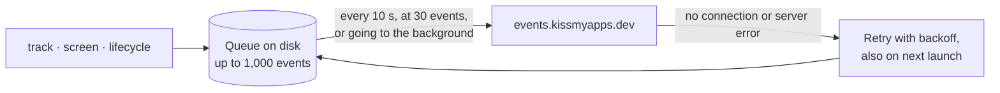

<p align="center">
  <a href="https://kissmyapps.dev">
    
  </a>
</p>

<h1 align="center">KissMyApps for iOS and Android</h1>

<p align="center">
  Installs, sessions, screens and your own events, from your app to your KissMyApps dashboard.<br>
  One line to start. Works offline. No dependencies. No advertising ID.
</p>

<p align="center">
  <a href="https://github.com/onorhime/kissmyapps-mobile/actions/workflows/ci.yml"></a>
  <a href="https://jitpack.io/#onorhime/kissmyapps-mobile"></a>
  
  
  
  <a href="LICENSE"></a>
</p>

<p align="center">
  <a href="#install">Install</a> ·
  <a href="#quick-start">Quick start</a> ·
  <a href="#track-what-matters">Track events</a> ·
  <a href="#what-gets-recorded">What gets recorded</a> ·
  <a href="#options">Options</a> ·
  <a href="#privacy">Privacy</a> ·
  <a href="#react-native-and-other-platforms">React Native</a>
</p>

---

## Why this SDK

- **Start it and you are done.** Installs, updates, opens, time in the app, sessions and
  screens are recorded on their own. Add your own events when you want more.
- **Nothing is lost offline.** Events wait on the phone, survive a restart and go out with
  backoff once there is a connection.
- **Small and plain.** Pure Swift and Kotlin on top of Foundation and the Android SDK. No
  third-party libraries, no code generation, no ProGuard rules.
- **Respectful by default.** A random ID per install, no advertising ID, no fingerprinting,
  and an opt-out that is remembered across launches.
- **One dashboard for every platform.** iOS, Android, React Native and the web send the
  same events, so the dashboard compares them side by side.

## Requirements

|                 | iOS                           | Android                        |
| --------------- | ----------------------------- | ------------------------------ |
| Minimum version | iOS 13                        | Android 5.0 (API 21)           |
| Build tools     | Xcode 14 or later (Swift 5.7) | Gradle; Kotlin 1.9+ or Java 8+ |
| Languages       | Swift, SwiftUI or UIKit       | Kotlin or Java                 |
| Install from    | Swift Package Manager         | JitPack                        |
| Permissions     | None                          | `INTERNET`, added for you      |

You also need a **client key** from your project in the KissMyApps console, under
**Settings → API keys**. Keys starting `kma_pk_live_` count as production; keys starting
`kma_pk_test_` are kept apart as development, so your test runs never mix with real users.
The console's **Install SDK** page shows every step below with your key already filled in.

## Install

### iOS: Swift Package Manager

In Xcode, choose **File → Add Package Dependencies…**, paste the address below and add the
**KissMyApps** library to your app target.

```text
https://github.com/onorhime/kissmyapps-mobile
```

Or, in a `Package.swift`:

```swift
dependencies: [
    .package(url: "https://github.com/onorhime/kissmyapps-mobile", from: "1.0.0"),
],
targets: [
    .target(name: "MyApp", dependencies: [
        .product(name: "KissMyApps", package: "kissmyapps-mobile"),
    ]),
]
```

### Android: Gradle with JitPack

Add JitPack to your repositories, then the library to your app module.

```kotlin
// settings.gradle.kts
dependencyResolutionManagement {
    repositories {
        google()
        mavenCentral()
        maven("https://jitpack.io")
    }
}
```

```kotlin
// app/build.gradle.kts
dependencies {
    implementation("com.github.onorhime:kissmyapps-mobile:1.0.0")
}
```

<details>
<summary>Using Groovy build files</summary>

```groovy
// settings.gradle
dependencyResolutionManagement {
    repositories {
        google()
        mavenCentral()
        maven { url 'https://jitpack.io' }
    }
}

// app/build.gradle
dependencies {
    implementation 'com.github.onorhime:kissmyapps-mobile:1.0.0'
}
```

</details>

## Quick start

Start the SDK once, as early as possible. That single call already records installs,
updates, opens, sessions and time in the app.

### iOS

```swift
import SwiftUI
import KissMyApps

@main
struct MyApp: App {
    init() {
        KissMyApps.start(key: "kma_pk_live_…")
    }

    var body: some Scene {
        WindowGroup { ContentView() }
    }
}
```

<details>
<summary>Using UIKit</summary>

```swift
import UIKit
import KissMyApps

@main
class AppDelegate: UIResponder, UIApplicationDelegate {
    func application(
        _ application: UIApplication,
        didFinishLaunchingWithOptions launchOptions: [UIApplication.LaunchOptionsKey: Any]?
    ) -> Bool {
        KissMyApps.start(key: "kma_pk_live_…")
        return true
    }
}
```

</details>

The app's version and build number are read from its `Info.plist`. When the app goes to
the background, the SDK asks iOS for a few seconds to send whatever is still queued.

### Android

```kotlin
import android.app.Application
import com.kissmyapps.KissMyApps

class MyApp : Application() {
    override fun onCreate() {
        super.onCreate()
        KissMyApps.start(this, "kma_pk_live_…")
    }
}
```

Register the class in your manifest with `<application android:name=".MyApp" …>` if you do
not have one already.

<details>
<summary>Using Java</summary>

```java
import android.app.Application;
import com.kissmyapps.KissMyApps;

public class MyApp extends Application {
    @Override
    public void onCreate() {
        super.onCreate();
        KissMyApps.start(this, "kma_pk_live_…");
    }
}
```

Every method is static, so the rest reads the same: `KissMyApps.track("lesson_completed")`.

</details>

The app's version name and code are read from its package.

> [!TIP]
> Open your app once with a development key (`kma_pk_test_…`). Within a minute, **Check your
> setup** on the console's Install SDK page lists "iOS app (development)" or "Android app
> (development)".

## Track what matters

### Your own events

```swift
// iOS
KissMyApps.track("lesson_completed", properties: ["lesson": 3, "score": 0.92])
```

```kotlin
// Android
KissMyApps.track("lesson_completed", mapOf("lesson" to 3, "score" to 0.92))
```

Event names use letters, numbers and `_ . : -`, start with a letter and are up to 80
characters, such as `checkout_started` or `lesson:completed`. A name outside those rules is
ignored, with a warning when `debug` is on. Property values can be text, numbers, booleans,
dates, `nil`/`null`, lists and nested maps, up to 32 KB per event.

### Screens

```swift
// iOS, SwiftUI: recorded each time the view appears
LessonView()
    .kmaScreen("Lesson")

// iOS, UIKit or anywhere else
KissMyApps.screen("Lesson")
```

```kotlin
// Android, in an Activity or Fragment
override fun onResume() {
    super.onResume()
    KissMyApps.screen("Lesson")
}

// Android, Jetpack Compose
LaunchedEffect(Unit) { KissMyApps.screen("Lesson") }
```

Every `screen_viewed` event carries the screen's `name` and the `previous` one, and later
events carry the screen they happened on, so funnels and paths line up without extra work.

### People

```swift
// iOS
KissMyApps.identify("user-42", traits: ["email": "amaka@example.com", "plan": "annual"])
KissMyApps.setTraits(["plan": "monthly"])
KissMyApps.reset() // on sign out: what follows belongs to a new, anonymous person
```

```kotlin
// Android
KissMyApps.identify("user-42", mapOf("email" to "amaka@example.com", "plan" to "annual"))
KissMyApps.setTraits(mapOf("plan" to "monthly"))
KissMyApps.reset()
```

`identify` joins the anonymous history from before sign-in to your user ID, so a person's
first visit and their purchase show up as one journey.

### Everything at a glance

Apart from the SwiftUI modifier, every call is on `KissMyApps`, such as `KissMyApps.flush()`.

| iOS                     | Android                        | What it does                                          |
| ----------------------- | ------------------------------ | ----------------------------------------------------- |
| `start(key:options:)`   | `start(context, key, options)` | Starts recording. Call once.                          |
| `track(_:properties:)`  | `track(name, properties)`      | Records one of your events.                           |
| `screen(_:properties:)` | `screen(name, properties)`     | Records a screen view.                                |
| `View.kmaScreen(_:)`    | –                              | SwiftUI shortcut for `screen`.                        |
| `identify(_:traits:)`   | `identify(userId, traits)`     | Ties this install to your user ID.                    |
| `setTraits(_:)`         | `setTraits(traits)`            | Updates what you know about the person.               |
| `reset()`               | `reset()`                      | Forgets the person and starts a new anonymous one.    |
| `optOut()` / `optIn()`  | `optOut()` / `optIn()`         | Stops or resumes sending. Remembered across launches. |
| `flush()`               | `flush()`                      | Sends what is queued now.                             |
| `anonymousId`           | `getAnonymousId()`             | This install's random ID, for support tickets.        |
| `sessionId`             | `getSessionId()`               | The current session's ID.                             |

Every call is safe from any thread and returns at once; the work happens on the SDK's own
serial queue. Calls made before `start` are kept and run as soon as it is called.

## What gets recorded

### Automatic events

| Event              | When                                       | Properties                                               |
| ------------------ | ------------------------------------------ | -------------------------------------------------------- |
| `session_started`  | A new session begins                       | –                                                        |
| `app_installed`    | The first launch after install             | `version`, `build`                                       |
| `app_updated`      | The first launch of a new version or build | `version`, `build`, `previous_version`, `previous_build` |
| `app_opened`       | The app comes to the foreground            | `from_background`                                        |
| `app_backgrounded` | The app leaves the foreground              | `seconds_in_foreground`                                  |
| `screen_viewed`    | You call `screen` or `.kmaScreen`          | `name`, `previous`, plus your own                        |

Set `trackLifecycle` to `false` to keep only sessions, screens and your own events.

A session ends after 30 minutes in the background or without events. While the app is
open, a light heartbeat every minute keeps the person counted as online in the dashboard.

### Context sent with every request

| Field                  | Example                             |
| ---------------------- | ----------------------------------- |
| Platform and OS        | `ios`, `iOS 18.1`                   |
| Device type and model  | `mobile`, `iPhone15,4` or `Pixel 7` |
| Screen size            | `393 × 852`                         |
| Language and time zone | `en-NG`, `Africa/Lagos`             |
| App version            | `2.4.0`                             |
| SDK version            | `kma-ios/1.0.0`                     |

Country, region and city are worked out by the KissMyApps server from the request's
address, which is only ever kept as a salted hash.

### Delivery and offline



- Each event is written to the app's own storage as soon as it is recorded, so a crash, a
  force quit or a dead network does not lose it.
- When the queue is full, the oldest events are dropped first.
- A request the server refuses outright (a 4xx, such as a revoked key) is dropped instead
  of retried forever; turn on `debug` to see why.

## Options

Pass options as the last argument to `start`. Every option has a default.

```swift
// iOS
KissMyApps.start(key: "kma_pk_live_…", options: KissMyAppsOptions(
    sessionTimeoutMinutes: 15,
    debug: true
))
```

```kotlin
// Android
KissMyApps.start(this, "kma_pk_live_…", KissMyAppsOptions(
    sessionTimeoutMinutes = 15,
    debug = BuildConfig.DEBUG,
))
```

| Option                  | Default                          | What it does                                                          |
| ----------------------- | -------------------------------- | --------------------------------------------------------------------- |
| `appVersion`            | From `Info.plist` or the package | The version shown in the dashboard.                                   |
| `build`                 | From `Info.plist` or the package | The build number, used to spot updates.                               |
| `endpoint`              | `https://events.kissmyapps.dev`  | Where events are sent.                                                |
| `sessionTimeoutMinutes` | `30`                             | Minutes in the background or idle before a new session starts.        |
| `flushIntervalSeconds`  | `10`                             | How often queued events are sent while the app is open.               |
| `maxQueue`              | `1000`                           | The most events kept while offline.                                   |
| `trackLifecycle`        | `true`                           | Record installs, updates, opens and backgrounding.                    |
| `debug`                 | `false`                          | Log refused events and other problems to the Xcode console or Logcat. |

## Privacy

- **Per-install ID only.** The anonymous ID is random, stored in the app's own storage and
  left out of device backups, so a restored phone counts as a new install. Nothing is shared
  with other apps.
- **No advertising identifiers.** The SDK never reads the IDFA or the Android advertising
  ID, and never asks for App Tracking Transparency.
- **No fingerprinting and no raw addresses.** The server turns the request's IP address into
  a country, region and city, then keeps only a salted hash of it.
- **Consent is one call.** `optOut()` stops all sending and clears the queue until
  `optIn()`, and the choice survives app restarts.
- **You decide what is personal.** Only the traits and properties you pass are sent; leave
  out anything you would not want in your dashboard.

When you fill in the App Store privacy details or the Google Play Data safety form, the
lists under [What gets recorded](#what-gets-recorded) are everything this SDK sends.

## React Native and other platforms

- **React Native and Expo:** [`@kissmyappss/react-native`](https://www.npmjs.com/package/@kissmyappss/react-native),
  plain JavaScript with no native code to link.
- **Websites:** the console's Install SDK page has the one-line script tag.
- **Anything else:** send the same JSON over HTTP; the format is in
  [`contract/app-events.json`](contract/app-events.json).

## How it is built

Each platform has a small, platform-free core (`Client` in [`ios/Sources`](ios/Sources/KissMyApps),
`KmaClient` in [`android/core`](android/core)) that holds every rule: sessions, the queue,
retries and the request format. Storage, HTTP, the clock and the device are passed in, so
the tests drive the core with a clock they control and check every request against
[`contract/app-events.json`](contract/app-events.json), the same file the server's tests use.

```sh
swift test                                   # iOS core, on macOS or Linux
cd android && ./gradlew -p core test         # Android core, on any JVM
cd android && ./gradlew :kissmyapps:assembleRelease
```

Set `KMA_CONTRACT_ENDPOINT` and `KMA_CONTRACT_KEY` to also run a test that sends a real launch
to a KissMyApps ingest and checks every event arrived.

```text
.
├── Package.swift          Swift package manifest
├── ios/                   Swift sources and tests
├── android/
│   ├── core/              Kotlin core and its JVM tests
│   └── kissmyapps/        The Android library JitPack builds
├── contract/              The request format every SDK is tested against
└── jitpack.yml
```

## Versioning

Releases follow [semantic versioning](https://semver.org) and are tagged here, which is
where both Swift Package Manager and JitPack read them. See [CHANGELOG.md](CHANGELOG.md) for
what changed.

## License

[MIT](LICENSE) © KissMyApps
